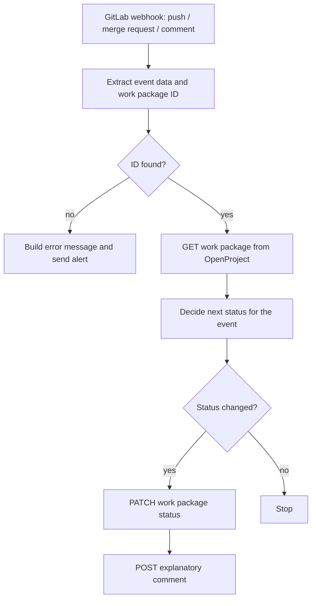

# gitlab-openproject-sync

An [n8n](https://n8n.io) workflow that keeps [OpenProject](https://www.openproject.org) work packages in step with the code in GitLab. When a developer pushes a branch or updates a merge request, the workflow finds the related work package and updates its status, so nobody has to do it by hand.

> **Status: work in progress.** See [Project status](#project-status) for what is built and what is planned.

## The problem

Developers write code in GitLab and track work in OpenProject. After coding, they have to update the work package status manually. That step is often skipped, so the tracker goes stale and says nothing about what actually changed in the code.

## The idea

GitLab sends webhooks to n8n. n8n reads a work package ID from the branch name or merge request title, checks it, and calls the OpenProject API to update the status and leave a comment. If something is wrong, such as a missing ID, it stops and raises an alert instead of failing silently.



## The work package ID convention

The ID is the only link between a GitLab event and a work package, so it has to appear somewhere the workflow can read it:

- Branch name: `feature/OP-12345_short-description`
- Merge request title: `[Feat][OP-12345] short description`
- Commit message (push events)

The workflow uses a forgiving pattern, so `OP-12345`, `OP_12345`, `OP 12345` and `OP#12345` all work:

```javascript
function extractOpId(text) {
  if (!text) return null;
  const match = text.match(/OP[- _#]?(\d+)/i);
  return match ? match[1] : null;
}
```

For merge request events the title, description and source branch are searched together.

## Design decisions

| Decision | Reason |
|---|---|
| Validate the ID with an **IF** node, not a Filter node | A Filter silently drops non-matching items, so failures never reach the error path. An IF node has explicit true and false outputs. |
| Use the test webhook URL while building and the production URL once activated | The test URL only listens after you click "Listen for test event". The production URL needs the workflow to be active. |
| Develop against **pinned data** | Pin a captured payload on the previous node so later nodes can be re-run without re-triggering the webhook. |
| Measure MR duration from `created_at` | The merge request webhook carries only the last commit. A true first-commit date would need an extra GitLab API call. |
| Count weekdays only | Weekends are skipped. Public holidays are not excluded yet. |

### Working-day duration

```javascript
function countWorkingDays(startDate, endDate) {
  let count = 0;
  const current = new Date(startDate);
  current.setHours(0, 0, 0, 0);
  const end = new Date(endDate);
  end.setHours(0, 0, 0, 0);
  while (current <= end) {
    const d = current.getDay();      // 0 = Sun, 6 = Sat
    if (d !== 0 && d !== 6) count++;
    current.setDate(current.getDate() + 1);
  }
  return count;
}
```

## Testing with GitHub payloads

My test repository is on GitHub, not GitLab, so the extraction step has to handle both payload shapes:

| Item | GitLab | GitHub |
|---|---|---|
| Event header | `x-gitlab-event` | `x-github-event` |
| PR / MR object | `body.object_attributes` | `body.pull_request` |
| Source branch | `object_attributes.source_branch` | `pull_request.head.ref` |
| Title | `object_attributes.title` | `pull_request.title` |
| Action | `object_attributes.action` | `body.action` |
| Draft | `object_attributes.draft` | `pull_request.draft` |
| Repository path | `project.path_with_namespace` | `repository.full_name` |

Troubleshooting notes from the build:

- **"No trigger output":** the webhook fired before n8n was listening. Click Listen first, then use Redeliver from the sender's recent deliveries.
- **404 from the sender:** the test URL was hit while n8n was not listening.
- **GitHub content type** must be `application/json`.

## Setup (outline)

1. Import the workflow into n8n and set the webhook path.
2. In GitLab, add a webhook pointing at the n8n URL for Push, Comments and Merge request events.
3. In OpenProject, create an integration account and an API token.
4. In n8n, create credentials (OpenProject basic auth with user `apikey`; GitLab API token). **Never commit tokens.**
5. Add your project to the allowlist inside the validation step.
6. Test with pinned data, then activate the workflow and switch to the production webhook URL.

## Project status

| Part | State |
|---|---|
| Webhook trigger receiving events | Done |
| Extract event data and work package ID | Done |
| Validate that an ID exists (IF node) | Done |
| Working-day duration for merge requests | Done |
| Adapt extraction to GitHub payloads | In progress |
| Fetch the work package and apply status transitions | Planned |
| Post comment and error alerts | Planned |
| Sync finished dev items to QA test items | Planned |

*Update this table as parts are finished. It should always match what the workflow actually does.*

## Not included

This repository has no credentials, real instance URLs, project names or company data. Workflow exports are sanitised: URLs, tokens, credential IDs and webhook paths are replaced with placeholders.

## Tech

n8n, GitLab webhooks, OpenProject API v3, JavaScript (n8n Code nodes)
