# n8n GitLab OpenProject Integration: Project Archive

## 1. Project goal and context

**Problem.** Developers write code in **GitLab** and track work in **OpenProject** (work packages: Task, User Story, Issue). After coding, they must manually update the work package status. This is often skipped, so OpenProject is stale and untrustworthy, and it captures no detail about code changes.

**Solution.** An **n8n** workflow acts as a bridge. GitLab sends webhooks to n8n, n8n extracts an **OPID** (OpenProject work package ID) from the branch name or MR title, then calls the OpenProject API to update status and post an explanatory comment.

**My role.** Intern building my own copy of the template workflow, learning each node before building it. Source document: `Guideliness Integration.md` (the team guideline).

**Own build environment (important difference from the template).**
- n8n instance: `https://app.n8n.cloud` (n8n Cloud)
- Own test repository is on **GitHub**, not GitLab. The captured webhook headers were `X-Github-Event: push`.
- The template, the company GitLab and OpenProject are all GitLab based.

---

## 2. Architecture

### 2.1 Components

| Component | Role |
|---|---|
| GitLab | Event source: Push, Merge Request, Note (and Job) webhooks |
| n8n | Automation engine: receives, validates, routes, calls APIs |
| OpenProject | Destination for status updates and comments; also emits webhooks back to n8n |
| Google Chat | Error alert channel (missing OPID, wrong project, API failures) |

### 2.2 Two flows

```mermaid
flowchart TD
    subgraph A[Flow A: GitLab to OpenProject]
    A1[Webhook: GitLab events] --> A2[Extract Gitlab Data]
    A2 --> A3{Validate Gitlab OPID}
    A3 -- true --> A4[GET OP Work Package]
    A3 -- false --> E1[Prepare error msg]
    A4 --> A5[GET OP List Statuses]
    A5 --> A6[Validate Project and OP Status]
    A6 --> A7{Filter Gitlab Event Type}
    A7 --> A8[Push branch]
    A7 --> A9[MR branch]
    A7 --> A10[Note branch]
    A8 --> A11{Filter WorkPackages Type}
    A9 --> A11
    A11 --> A12[Handle Task / User Story / Issue Transition]
    A12 --> A13[Build Patch Payload]
    A13 --> A14{Validate Changed Status}
    A14 -- changed --> A15[PATCH OP Work Package]
    A15 --> A16[Build and Post OP Comment]
    E1 --> E2[Send Google Chat alert]
    end
    subgraph B[Flow B: OpenProject to OpenProject sync]
    B1[Webhook: OP work package updated] --> B2[Validate OP Fields]
    B2 --> B3{Validate Test}
    B3 --> B4[GET Parent Work Package]
    B4 --> B5[Handle Test Transition]
    B5 --> B6{Validate Finished Item}
    B6 --> B7[Check Test Items]
    B7 --> B8{Validate to Create}
    B8 --> B9[Build payload then POST Create Test Item]
    end
```



**Flow B purpose.** When a dev item reaches a finished state (Solved, Done, Developed), OpenProject fires a webhook and n8n creates or updates **Test Items** for SQA, removing the manual Dev to QA handoff.

### 2.3 Key concept: the OPID

The OPID is the only link between a GitLab event and a work package. Developers must put it in a branch name, MR title or commit message, for example `feature/OP-141973_adding-information`. No OPID means the workflow stops and alerts Google Chat.

---

## 3. Node reference (34 nodes)

Naming convention: nodes prefixed `[UserSettings]` / `[User Settings]` / `[User settings]` hold per-project config (URLs, credentials, project names). Other nodes are generic logic.

### Flow A (24 nodes)

| # | Node | Type | Purpose |
|---|---|---|---|
| 1 | `[UserSettings] Gitlab Webhooks` | Webhook | Entry point for GitLab events |
| 2 | `Extract Gitlab Data` | Code | Parse payload, extract OPID and context |
| 3 | `Validate Gitlab OPID` | Code, if | Continue only if OPID exists |
| 4 | `[UserSettings] Get OP Work Package` | HTTP GET | Fetch work package by OPID |
| 5 | `[User Settings] GET OP List Statuses` | HTTP GET | Fetch status names to IDs |
| 6 | `[User settings] Validate Project & OP Status` | Code | Project allowlist check and status ID extraction |
| 7 | `Filter Gitlab Event Type` | Switch | Route: MR, Push, Note, error |
| 8 | `Determine Push Event` | Code | Branch creation, deletion, or normal push |
| 9 | `Validate Normal Push` | Code, if | Only branch creation proceeds |
| 10 | `Extract Merge Request Context` | Code | Flags: ismrNew, Draft, Opened, Approved, Merged, Closed, Reopened |
| 11 | `Filter WorkPackages Type` | Switch | Route: Task, User Story, Issue |
| 12 | `Handle Task Transition` | Code | Next status for Task |
| 13 | `Handle User Story Transition` | Code | Next status for User Story |
| 14 | `Handle Issue Transition` | Code | Next status for Issue |
| 15 | `Build Work Package Patch Payload` | Code | Build status PATCH body |
| 16 | `Validate Changed Status` | Code, if | Skip if status unchanged |
| 17 | `[User Settings] Update OP Work Package` | HTTP PATCH | Apply status |
| 18 | `Build Work MR Comment` | Code | Compose activity comment |
| 19 | `[User Settings] Post OP Comment` | HTTP POST | Post comment to work package |
| 20 | `[User Settings] Prepare Validation Error Message` | Code | Build error message |
| 21 | `[User Settings] Send Validation Error Notification` | HTTP POST | Send to Google Chat |
| 22 | `Validate Changed Description Gitlab` | Code, if | Is OP link already in MR description |
| 23 | `Build Gitlab Patch Payload` | Code | Append OP link to MR description |
| 24 | `No Operation, do nothing` | Built-in | Terminal node |

### Flow B (10 nodes)

| # | Node | Type | Purpose |
|---|---|---|---|
| 25 | `[UserSettings] Open Projects Webhooks` | Webhook | Entry for OP update events |
| 26 | `[User settings] Validate OP Fields & Extract OP` | Code | Project allowlist (`allowedOpenProject`) and extraction |
| 27 | `Validate Test` | Code, if | Only Test type continues |
| 28 | `[UserSettings] Get OP Parent Work Package` | HTTP GET | Fetch parent (e.g. User Story) |
| 29 | `Handle Test Transition` | Code | Next status for Test item |
| 30 | `Validate Finished Item` | Code, if | Only completed items continue |
| 31 | `[User Settings] Check Test Items` | HTTP GET | Look for existing Test items |
| 32 | `Validate to Create Test Items` | Code, if | Skip creation if one exists |
| 33 | `Build Test Items Patch Payload` | Code | Build create payload |
| 34 | `[User Settings] Create Items Test` | HTTP POST | Create Test item in OP |

### Documentation 
1. `[UserSettings]` prefix is written three ways: `[UserSettings]`, `[User Settings]`, `[User settings]`.
2. Type column says "Nodos" for `No Operation` (stray Spanish word).
3. `[User Settings] Validate Work Package Type (Repo and Type)` is used in setup Step 6 but missing from the node table.
4. `GET OP List Statuses` appears in setup Step 11 but the table description is thin.
5. `Build Gitlab Patch Payload` has no paired HTTP send node listed.

---

## 4. Setup procedure for a new repository

### 4.1 Webhook node (built)

1. Add a **Webhook** node, method POST.
2. Set a clear path, for example `integration-yourproject`.
3. While building, use the **test URL** and click **Listen for test event**. Switch to the production URL only when the workflow is activated.
4. In GitLab: *Settings → Webhooks*, paste the URL and tick **Push events**, **Comments** and **Merge request events**.

Test: trigger an event (push a branch). If n8n shows no output, the event fired before n8n was listening. Click Listen first, then use **Redeliver** in the sender's recent deliveries.

### 4.2 Extract Data (built)

A **Code** node that reads the incoming item and branches on the `x-gitlab-event` header (`Push Hook`, `Merge Request Hook`, `Note Hook`, `Job Hook`). For each event it returns a flat object: the work package ID, event name, project, author, title, source and target branch, state and action.

The ID extractor:

```javascript
function extractOpId(text) {
  if (!text) return null;
  const match = text.match(/OP[- _#]?(\d+)/i);
  return match ? match[1] : null;
}
```

For merge request events, search the title, description and source branch together. For push events, search the branch name and commit messages.

Things to guard against:

- Null author names: `const [first = null, last = null] = (authorName ?? "").split(" ");`
- Branches with no underscore: do not index a `split("_")` result without checking it.
- Unknown events: return a clear "event not allowed" result instead of crashing.

Test: pin a captured payload on the webhook node, then run only this node as many times as you like.

### 4.3 Validate ID (built)

Use an **IF** node, not a Filter node.

- Filter silently drops items that do not match, so the failure never reaches your error path.
- IF gives an explicit true and false output.

Condition: value `{{ $json.opId }}`, operator **is not empty**. Choose the operator from the dropdown. Typing "is not empty" into the value field compares against that literal text and always fails.

The false output goes to the error path (step 15).

### 4.4 Get Work Package (planned)

HTTP Request, GET `/api/v3/work_packages/{opId}`. Auth: Basic Auth, user `apikey`, password = your OpenProject token. The response gives the current status, type and project.

### 4.5 List Statuses (planned)

HTTP Request, GET `/api/v3/statuses`. You need this to turn a status name like "In progress" into the ID the PATCH call requires.

### 4.6 Validate Project (planned)

A Code node holding an allowlist of project names. If the work package's project is not on the list, stop and alert. This protects projects that did not opt in.

### 4.7 Routing, classification and transitions (planned)

- A **Switch** node on the event type sends push, merge request and comment events down separate branches.
- Push: classify as branch created, deleted or normal push. Only a newly created branch starts work.
- Merge request: set flags for new, draft, opened, approved, merged, closed and reopened.
- A second **Switch** on work package type lets Task, User Story and Issue use different transition tables.
- Each transition handler is a Code node that maps (current status, event) to the next status.

Keep the transition tables in one place per type so they are easy to change.

### 4.8 Apply the update (planned)

1. **Build Patch Payload:** the new status ID and the work package `lockVersion` (OpenProject rejects updates without it).
2. **Validate Changed Status:** an IF node that skips the PATCH when the status is the same.
3. **PATCH** the work package.
4. **Build and post a comment** such as "Status updated to In Progress, triggered by merge request opened on branch feature/OP-123_example".

### 4.9 Error path (planned)

A Code node builds a readable message (missing ID, project not allowed, API error) and an HTTP Request node posts it to your chat webhook URL. Keep the webhook URL in a credential or environment variable, not in the exported workflow.

---


## 5. Optional: merge request duration

Working days from the merge request's creation date to today, weekends skipped:

```javascript
function countWorkingDays(startDate, endDate) {
  let count = 0;
  const current = new Date(startDate);
  current.setHours(0, 0, 0, 0);
  const end = new Date(endDate);
  end.setHours(0, 0, 0, 0);
  while (current <= end) {
    const d = current.getDay();          // 0 = Sun, 6 = Sat
    if (d !== 0 && d !== 6) count++;
    current.setDate(current.getDate() + 1);
  }
  return count;
}
```

Limits: no public holiday list, and `created_at` is used because the webhook only carries the last commit.

---

## 6. Credentials

Create credentials in n8n. Do not paste tokens into nodes or commit them.

| Credential | Setup |
|---|---|
| OpenProject (Basic Auth) | User `apikey`, password = the OpenProject API token. Create a dedicated integration account, add it to the project, then *Account settings → Access tokens*. |
| GitLab API | A project or personal access token with `api` and `read_api` scopes. Setting one up needs the Maintainer role. |

Apply the OpenProject credential to every HTTP Request node that calls OpenProject.

---

## 7. Testing checklist

- [ ] Webhook receives a real event (test URL, Listen first)
- [ ] Extract Data returns the right ID for a branch, a merge request title and a commit message
- [ ] A branch with no ID goes down the false path
- [ ] Pinned data lets you re-run later nodes without re-triggering
- [ ] The status PATCH changes the status once and does not repeat when unchanged
- [ ] The error alert arrives and contains no secrets
- [ ] Activate the workflow and switch the webhook to the production URL

---

## 8. Common problems

| Symptom | Cause and fix |
|---|---|
| "No trigger output" | The sender fired before n8n was listening. Click Listen, then Redeliver. |
| 404 from the sender | The test URL was called while n8n was not listening. |
| IF node always false | Wrong operator or no ID in the data. Check the Extract node output first. |
| Extract returns no ID on GitHub data | The code reads GitLab fields. See section 8. |
| PATCH rejected | Missing `lockVersion` or an invalid status ID. |

---

## 9. Testing with GitHub instead of GitLab

If your test repository is on GitHub, the payload fields differ:

| Item | GitLab | GitHub |
|---|---|---|
| Event header | `x-gitlab-event` | `x-github-event` |
| PR / MR object | `body.object_attributes` | `body.pull_request` |
| Source branch | `object_attributes.source_branch` | `pull_request.head.ref` |
| Title | `object_attributes.title` | `pull_request.title` |
| Action | `object_attributes.action` | `body.action` |
| Draft | `object_attributes.draft` | `pull_request.draft` |
| Repository path | `project.path_with_namespace` | `repository.full_name` |

Set the webhook content type to `application/json`, and branch your Extract node on whichever header is present.

---

## 10. Next steps

1. Adapt Extract Data to GitHub payloads (or test with a real GitLab event).
2. Build steps 4 to 6, then the routing and transitions.
3. Add the error alerts.
4. Optional: replace `created_at` with the true first-commit date through the GitLab API, and exclude public holidays from the duration.
5. Optional: sync finished development items to QA test items through an OpenProject webhook.