# n8n GitLab OpenProject Integration: Project Archive

## 1. Project goal and context

**Problem.** Developers write code in **GitLab** and track work in **OpenProject** (work packages: Task, User Story, Issue). After coding, they must manually update the work package status. This is often skipped, so OpenProject is stale and untrustworthy, and it captures no detail about code changes.

**Solution.** An **n8n** workflow acts as a bridge. GitLab sends webhooks to n8n, n8n extracts an **OPID** (OpenProject work package ID) from the branch name or MR title, then calls the OpenProject API to update status and post an explanatory comment.

**My role.** Intern building my own copy of the template workflow, learning each node before building it. Source document: `Guideliness Integration.md` (the team guideline).

**Own build environment (important difference from the template).**
- n8n instance: `https://app.n8n.cloud` (n8n Cloud)
- Own test repository is on **GitHub**, not GitLab. The captured webhook headers were `X-Github-Event: push`.
- The template, the company GitLab and OpenProject are all GitLab based.

---

## 2. Architecture

### 2.1 Components

| Component | Role |
|---|---|
| GitLab | Event source: Push, Merge Request, Note (and Job) webhooks |
| n8n | Automation engine: receives, validates, routes, calls APIs |
| OpenProject | Destination for status updates and comments; also emits webhooks back to n8n |
| Google Chat | Error alert channel (missing OPID, wrong project, API failures) |

### 2.2 Two flows

```mermaid
flowchart TD
    subgraph A[Flow A: GitLab to OpenProject]
    A1[Webhook: GitLab events] --> A2[Extract Gitlab Data]
    A2 --> A3{Validate Gitlab OPID}
    A3 -- true --> A4[GET OP Work Package]
    A3 -- false --> E1[Prepare error msg]
    A4 --> A5[GET OP List Statuses]
    A5 --> A6[Validate Project and OP Status]
    A6 --> A7{Filter Gitlab Event Type}
    A7 --> A8[Push branch]
    A7 --> A9[MR branch]
    A7 --> A10[Note branch]
    A8 --> A11{Filter WorkPackages Type}
    A9 --> A11
    A11 --> A12[Handle Task / User Story / Issue Transition]
    A12 --> A13[Build Patch Payload]
    A13 --> A14{Validate Changed Status}
    A14 -- changed --> A15[PATCH OP Work Package]
    A15 --> A16[Build and Post OP Comment]
    E1 --> E2[Send Google Chat alert]
    end
    subgraph B[Flow B: OpenProject to OpenProject sync]
    B1[Webhook: OP work package updated] --> B2[Validate OP Fields]
    B2 --> B3{Validate Test}
    B3 --> B4[GET Parent Work Package]
    B4 --> B5[Handle Test Transition]
    B5 --> B6{Validate Finished Item}
    B6 --> B7[Check Test Items]
    B7 --> B8{Validate to Create}
    B8 --> B9[Build payload then POST Create Test Item]
    end
```



**Flow B purpose.** When a dev item reaches a finished state (Solved, Done, Developed), OpenProject fires a webhook and n8n creates or updates **Test Items** for SQA, removing the manual Dev to QA handoff.

### 2.3 Key concept: the OPID

The OPID is the only link between a GitLab event and a work package. Developers must put it in a branch name, MR title or commit message, for example `feature/OP-141973_adding-information`. No OPID means the workflow stops and alerts Google Chat.

---

## 3. Node reference (34 nodes)

Naming convention: nodes prefixed `[UserSettings]` / `[User Settings]` / `[User settings]` hold per-project config (URLs, credentials, project names). Other nodes are generic logic.

### Flow A (24 nodes)

| # | Node | Type | Purpose |
|---|---|---|---|
| 1 | `[UserSettings] Gitlab Webhooks` | Webhook | Entry point for GitLab events |
| 2 | `Extract Gitlab Data` | Code | Parse payload, extract OPID and context |
| 3 | `Validate Gitlab OPID` | Code, if | Continue only if OPID exists |
| 4 | `[UserSettings] Get OP Work Package` | HTTP GET | Fetch work package by OPID |
| 5 | `[User Settings] GET OP List Statuses` | HTTP GET | Fetch status names to IDs |
| 6 | `[User settings] Validate Project & OP Status` | Code | Project allowlist check and status ID extraction |
| 7 | `Filter Gitlab Event Type` | Switch | Route: MR, Push, Note, error |
| 8 | `Determine Push Event` | Code | Branch creation, deletion, or normal push |
| 9 | `Validate Normal Push` | Code, if | Only branch creation proceeds |
| 10 | `Extract Merge Request Context` | Code | Flags: ismrNew, Draft, Opened, Approved, Merged, Closed, Reopened |
| 11 | `Filter WorkPackages Type` | Switch | Route: Task, User Story, Issue |
| 12 | `Handle Task Transition` | Code | Next status for Task |
| 13 | `Handle User Story Transition` | Code | Next status for User Story |
| 14 | `Handle Issue Transition` | Code | Next status for Issue |
| 15 | `Build Work Package Patch Payload` | Code | Build status PATCH body |
| 16 | `Validate Changed Status` | Code, if | Skip if status unchanged |
| 17 | `[User Settings] Update OP Work Package` | HTTP PATCH | Apply status |
| 18 | `Build Work MR Comment` | Code | Compose activity comment |
| 19 | `[User Settings] Post OP Comment` | HTTP POST | Post comment to work package |
| 20 | `[User Settings] Prepare Validation Error Message` | Code | Build error message |
| 21 | `[User Settings] Send Validation Error Notification` | HTTP POST | Send to Google Chat |
| 22 | `Validate Changed Description Gitlab` | Code, if | Is OP link already in MR description |
| 23 | `Build Gitlab Patch Payload` | Code | Append OP link to MR description |
| 24 | `No Operation, do nothing` | Built-in | Terminal node |

### Flow B (10 nodes)

| # | Node | Type | Purpose |
|---|---|---|---|
| 25 | `[UserSettings] Open Projects Webhooks` | Webhook | Entry for OP update events |
| 26 | `[User settings] Validate OP Fields & Extract OP` | Code | Project allowlist (`allowedOpenProject`) and extraction |
| 27 | `Validate Test` | Code, if | Only Test type continues |
| 28 | `[UserSettings] Get OP Parent Work Package` | HTTP GET | Fetch parent (e.g. User Story) |
| 29 | `Handle Test Transition` | Code | Next status for Test item |
| 30 | `Validate Finished Item` | Code, if | Only completed items continue |
| 31 | `[User Settings] Check Test Items` | HTTP GET | Look for existing Test items |
| 32 | `Validate to Create Test Items` | Code, if | Skip creation if one exists |
| 33 | `Build Test Items Patch Payload` | Code | Build create payload |
| 34 | `[User Settings] Create Items Test` | HTTP POST | Create Test item in OP |

### Documentation issues found in the guideline

1. `[UserSettings]` prefix is written three ways: `[UserSettings]`, `[User Settings]`, `[User settings]`.
2. Type column says "Nodos" for `No Operation` (stray Spanish word).
3. `[User Settings] Validate Work Package Type (Repo and Type)` is used in setup Step 6 but missing from the node table.
4. `GET OP List Statuses` appears in setup Step 11 but the table description is thin.
5. `Build Gitlab Patch Payload` has no paired HTTP send node listed.

---

## 4. Setup procedure for a new repository (from the guideline)

1. Duplicate the template workflow in n8n and rename it to the project.
2. Open `[UserSettings] Gitlab Webhooks`, set the path (e.g. `integration-projectname`), copy the URL.
3. GitLab: Settings, Webhooks, paste URL. Enable **Push**, **Comments**, **Merge request events**.
4. OpenProject: create a dedicated integration account, add it to the project, generate an API token (Account Settings, Access Tokens).
5. GitLab: Settings, Access Tokens. Role **Maintainer**, scopes `api` and `read_api` (Maintainer required).
6. n8n credentials:
   - Basic Auth: user `apikey`, password = OpenProject token
   - GitLab API: server `https://gitlab.[name].com`, token = GitLab token
7. Edit `[User Settings] Validate Work Package Type (Repo and Type)`: register the OpenProject project name and GitLab repo path.
8. Google Chat: create a space webhook, put the URL in `[User Settings] Send Validation Error Notification`. Optional thread grouping: append `&messageReplyOption=REPLY_MESSAGE_FALLBACK_TO_NEW_THREAD` to the URL, or remove the `thread` key from the JSON body for separate messages.
9. OpenProject webhook (administrator only): Settings, API and Webhooks. Payload URL from n8n (e.g. `integrationop-projectname`), event Work Package **Updated**, selected projects only.
10. In `[User settings] Validate OP Fields & Extract OP` set `const allowedOpenProject = { "your-projectname" };`
11. Apply the Basic Auth credential to all 7 OpenProject HTTP nodes: Get OP Work Package, GET OP List Statuses, Get OP Parent Work Package, Update OP Work Package, Check Test Items, Create Items Test, Post OP Comment.

---

## 5. Technical decisions and lessons

| Decision | Reason |
|---|---|
| Use an **IF** node (not Filter) for OPID validation | Filter silently drops non-matching items, so failures never reach the error path. IF gives explicit true and false outputs. |
| Condition is `{{ $json.opId }}` with operator **is not empty** | Operator must be chosen from the dropdown. Typing "is not empty" into the second field compares against that literal text. |
| Use `webhook-test` URL while building, `webhook` URL in production | Test URL only listens after clicking **Listen for test event**; Production URL needs the workflow **activated**. |
| Test with pinned data | Pin a captured payload on the previous node so downstream nodes can be executed repeatedly without re-triggering the webhook. |
| Duration measured from MR `created_at` (Option A) | The MR webhook only carries the **last** commit, not the first. A true first commit date needs an extra GitLab API call (Option B, not built). |
| Duration counts weekdays only | Team uses a 5 day work week. Public holidays are not excluded yet. |

**Webhook troubleshooting learned**
- "No trigger output": GitHub or GitLab fired before n8n was listening. Click Listen first, then use **Redeliver** from Recent Deliveries.
- GitHub delivery returned **404**: the test URL was hit while n8n was not listening. The request URL was correct (`.../webhook-test/a5a6a494-2385-4e93-9bd1-b9d4247f315c`).
- GitHub content type must be `application/json`.

**GitHub versus GitLab payload mapping (needed for the own build)**

| Item | GitLab | GitHub |
|---|---|---|
| Event header | `x-gitlab-event` | `x-github-event` |
| PR or MR object | `body.object_attributes` | `body.pull_request` |
| Source branch | `object_attributes.source_branch` | `pull_request.head.ref` |
| Title | `object_attributes.title` | `pull_request.title` |
| Action | `object_attributes.action` | `body.action` |
| Draft | `object_attributes.draft` | `pull_request.draft` |
| Author | `user.name` | `pull_request.user.login` |
| Repo path | `project.path_with_namespace` | `repository.full_name` |

---

## 6. Code: `Extract Gitlab Data` (template) and fixes

### 6.1 How the template works

Code node reading `$input.first().json`. Shared setup extracts `headers`, `body`, `oa = body.object_attributes`, `project`, `user`. It then branches on `headers['x-gitlab-event']`:

- `Push Hook`: branch from `body.ref`, commits, `before`/`after` SHA, author from top level `body.user_name`
- `Merge Request Hook`: title, description, source and target branch, state, action, draft, conflicts, assignees, reviewers, dates, author from `body.user`
- `Note Hook`: note text, MR from `body.merge_request`, OPID from source branch
- `Job Hook`: build status, failure reason, runner type
- anything else: returns `{ text: 'Events trigger : <url|event> not allowed for automation' }`

OPID extractor (finalized, kept as is):

```javascript
function extractOpId(text){
  if(!text) return null;
  const match = text.match(/OP[- _#]?(\d+)/i);
  return match ? match[1] : null;
}
// MR hook searches title + description + source branch together
const titleText = `${title} ${description} ${sourceBranch}`;
opId = extractOpId(titleText);
```

Return shape for MR events (what downstream nodes read): `opId, glEvent, eventName, mrIid, projectId, projectName, projectPath, projectUrl, authorName, authorEmail, authorAvatar, authorFirstName, authorLastName, assigneesName, reviewersName, title, eventUrl, createDate, updateDate, isDraft, isConflict, sourceBranch, targetBranch, targetUrl, state, action, branchType, branchTitle, nameLastCommit, emailLastCommit, description`.

### 6.2 Issues found in the template and proposed fixes

| # | Issue | Fix |
|---|---|---|
| 1 | `branchTitle` uses `split("_")[1]`, breaks when branch has no underscore | see snippet below |
| 2 | `sourceBranch.web_url` is read from a string, always `undefined` (dead code) | delete it |
| 3 | `authorName.split(' ')` crashes when name is null | `const [authorFirstName = null, authorLastName = null] = (authorName ?? "").split(' ');` |
| 4 | OPID regex is broad but intentional | keep |
| 5 | Job Hook returns no `opId` or author; typo `runnerTyoe` | rename to `runnerType`, add fields if needed |
| 6 | Push Hook variable `commitId` is actually an OPID | rename `commitOpId` |

```javascript
// Safer branchTitle
branchTitle = sourceBranch
  ?.replace(/^[^/]+\//, "")          // drop "feature/"
  ?.replace(/OP[-_]?\d+[-_]?/i, "")  // drop OPID
  ?.replace(/[-_]/g, " ")            // separators to spaces
  ?.trim() ?? null;
```

Also noted as unused in the Push branch: `commitTitles`, `commitsLatest`. These fixes were proposed but a full corrected version of the node was **not** produced yet.

### 6.3 Working day duration (finalized, Merge Request branch)

Goal: working days from MR `created_at` to today, weekends skipped.

```javascript
function countWorkingDays(startDate, endDate) {
  let count = 0;
  const current = new Date(startDate);
  current.setHours(0, 0, 0, 0);
  const end = new Date(endDate);
  end.setHours(0, 0, 0, 0);
  while (current <= end) {
    const d = current.getDay();      // 0 = Sun, 6 = Sat
    if (d !== 0 && d !== 6) count++;
    current.setDate(current.getDate() + 1);
  }
  return count;
}

const mrStartDate = new Date(createdMR);
const workingDays = countWorkingDays(mrStartDate, new Date());
const durationLabel = workingDays === 0 ? "Created today"
  : workingDays === 1 ? "1 working day"
  : `${workingDays} working days`;
// add workingDays and durationLabel to the returned json
```

Limits: no public holiday list; start day is counted inclusively; `created_at` is used instead of the true first commit date.

---

## 7. Real payload reference (MR event captured from GitLab)

- Header: `x-gitlab-event: Merge Request Hook`, `object_kind: merge_request`
- Project: id `1380`, name `Git Training`, path `Software/git-training`
- MR: iid `45`, title `Draft: [Feat][OP-141973] adding information`, source `feature/OP-141973_adding-information`, target `main`, `state: opened`, `action: update`, `draft: true`
- Last commit message `Update gitlabapi` (no OPID, which is fine because title and branch carry it)
- MR description already contains `https://openproject.[name].com/projects/test-project/work_packages/141973/activity`
- Expected extraction: `opId = "141973"`

---

## 8. Current build state

**Done (own workflow)**
- Webhook node receiving events (first real payload captured via redeliver)
- `Extract Gitlab Data` code reviewed and understood
- `Validate Gitlab OPID` IF node built with correct operator
- Working day duration code written

**Not started**
- `Get OP Work Package` and everything after it in Flow A
- All of Flow B
- Credentials, Google Chat webhook, project allowlists

---

## 9. Open tasks and next steps

1. **Resolve the IF node returning false.** The question of what `opId` and `glEvent` show in the `Extract Gitlab Data` output was never answered. Likely cause (inference, not confirmed): the own build receives **GitHub** payloads, which have no `x-gitlab-event` header, so `glEvent` is `null`, the code falls into the final `else` branch, and no `opId` is returned. Fix by either adapting the extractor to GitHub fields (section 5 table) or testing with a real GitLab payload.
2. Decide the strategy: keep GitHub for the own build (rewrite Extract node, header check `x-github-event`, `pull_request` fields) or point to a GitLab repo to match the template exactly.
3. Produce a corrected full `Extract Gitlab Data` node with fixes 1, 2, 3, 5, 6 applied.
4. Build `Get OP Work Package` (HTTP GET, Basic Auth `apikey` plus token), then `GET OP List Statuses`.
5. Build the error path: `Prepare Validation Error Message` and Google Chat notification.
6. Continue down Flow A: project validation, event routing, transition handlers, PATCH, comment.
7. Optional: replace `created_at` with true first commit date via `GET /api/v4/projects/:id/merge_requests/:iid/commits` (last item of the array). Optional: add public holiday exclusion.
8. Fix the guideline inconsistencies listed in section 3.
9. Test end to end with pinned data, then activate the workflow and switch the webhook to the production URL.

---

## 10. Deliverables already produced
- `n8n-workflow-explained.md`: node by node explanation of all 34 nodes.

---
